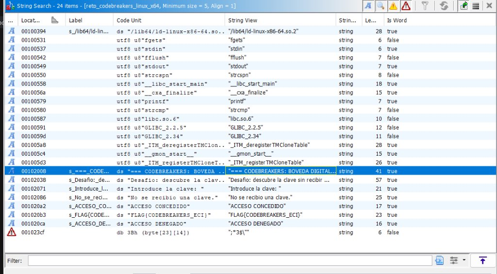
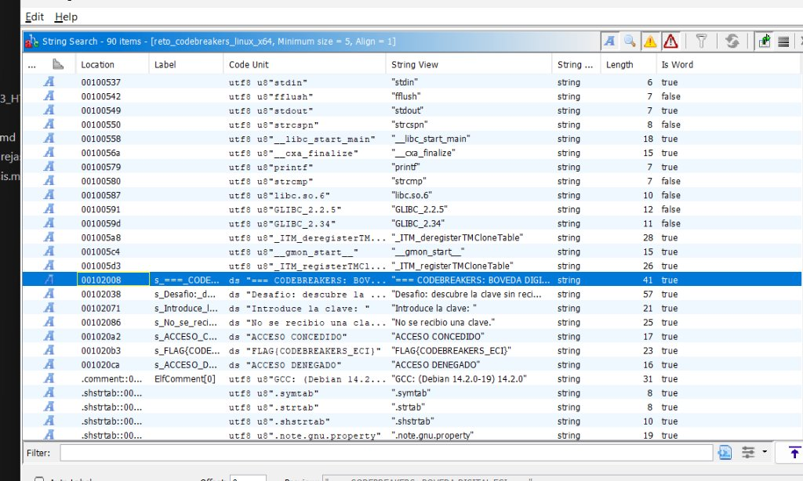
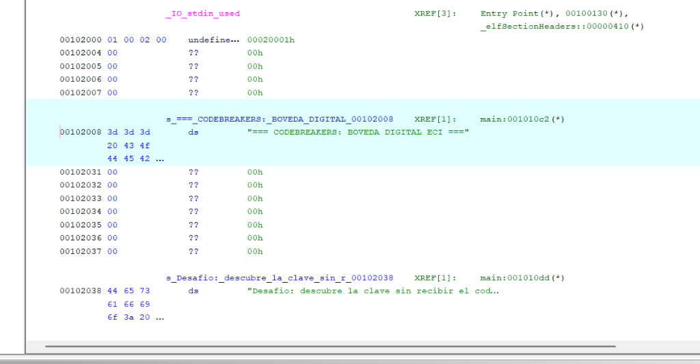
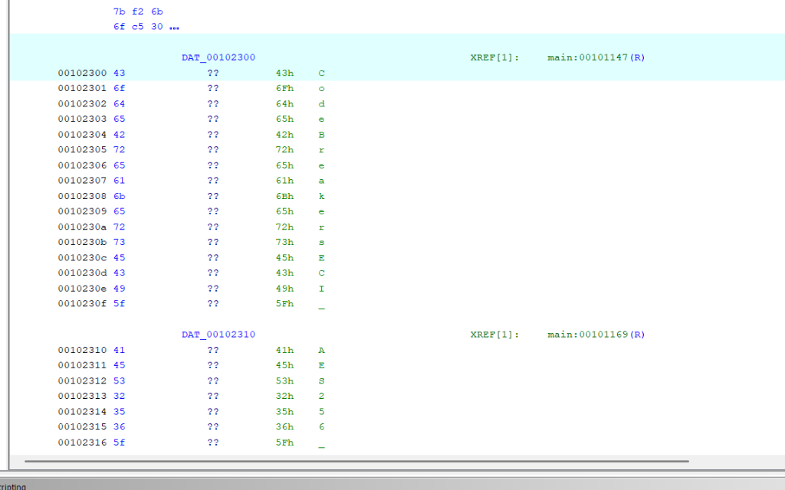
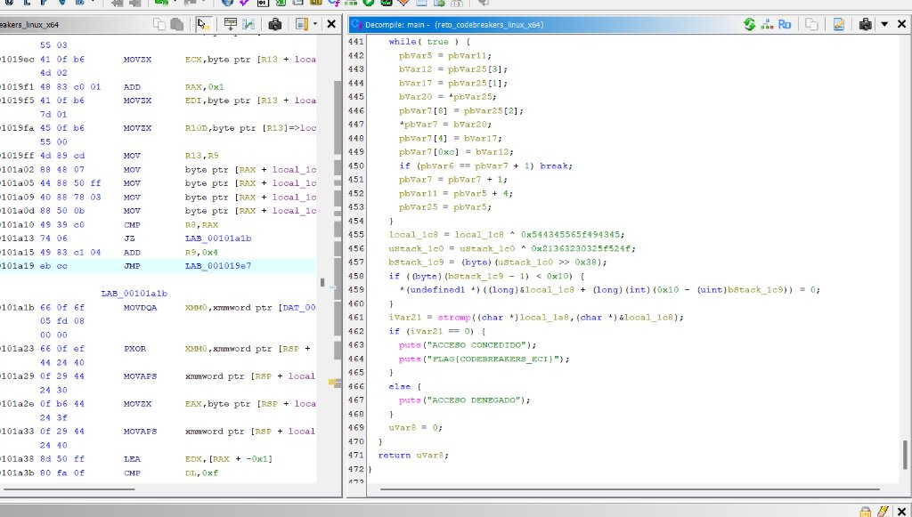
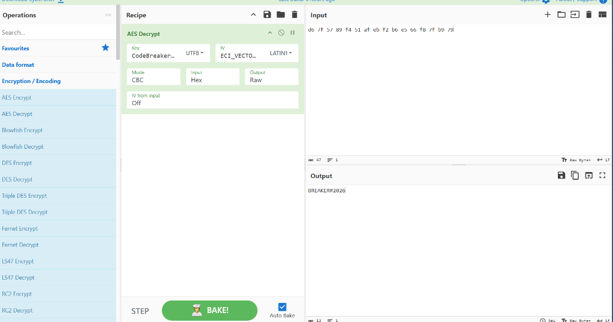

# Informe Técnico — Reto Code Breaker (Ingeniería Inversa y Criptoanálisis)

**Asignatura:** Fundamentos de Seguridad de la Información (FDSI)  
**Actividad:** Code Breaker — El Misterio del Código Oculto (Eciciencia 2026 / Lab 6)  
**Grupo:** G06  
**Integrantes:**
- Kevin Andrey Ángel Acevedo
- Sergio Daniel Buitrago Suancha
- Daniel Julian Peña Bonilla  

**Objetivo Evaluado:** Ejecutable ELF Linux x86-64 (`reto_codebreakers_linux_x64`)  
**Fecha:** 4 de Noviembre de 2026  

---

## 1. Resumen Ejecutivo

En la actividad **Code Breaker**, el equipo de seguridad recibió un ejecutable compilado en formato ELF de 64 bits (`reto_codebreakers_linux_x64`) que protege el acceso a una bóveda digital mediante una contraseña sin proporcionar el código fuente.

Mediante ingeniería inversa con **Ghidra** y análisis criptográfico con **CyberChef** y terminal **Linux/WSL**, se determinó que la contraseña no se encontraba almacenada en texto plano, sino cifrada mediante el algoritmo estándar **AES-256 en modo CBC**.

### Resultados Clave:
| Parámetro | Valor Recuperado |
|---|---|
| **Clave en Texto Claro** | `BREAKER#2026` |
| **Bandera (Flag) Obtenida** | `FLAG{CODEBREAKERS_ECI}` |
| **Algoritmo de Cifrado** | AES-256-CBC con padding PKCS#7 |
| **Clave AES-256 Embebida** | `CodeBreakersECI_AES256_KEY_2026!` (32 bytes) |
| **Vector de Inicialización (IV)** | `ECI_VECTOR_2026!` (16 bytes) |
| **Ciphertext (`aes_ct`)** | `d6 7f 57 89 f4 51 af eb f2 b6 e5 66 f8 7f b9 79` |
| **Punto de Decisión Lógica** | Función `main`, llamada `strcmp` (Línea 461) |

---

## 2. Metodología de Ingeniería Inversa

El procedimiento se dividió en cinco etapas sistemáticas:

```
[1. Carga e Inspección ELF en Ghidra] 
         │
         ▼
[2. Búsqueda de Cadenas y Análisis .rodata] 
         │
         ▼
[3. Descompilación de main y Localización de strcmp] 
         │
         ▼
[4. Criptoanálisis Manual (CyberChef / AES-256-CBC)] 
         │
         ▼
[5. Validación Dinámica en WSL / HTML y Captura de Flag]
```

---

## 3. Fase 1: Búsqueda de Cadenas e Inspección de Memoria

Al abrir el binario en Ghidra e invocar **Search $\rightarrow$ For Strings...**, se detectaron textos legibles correspondientes a los mensajes de la interfaz de usuario:


*Figura 1: Tabla de cadenas identificando los mensajes de la bóveda, prompt de entrada y mensajes de acceso.*


*Figura 2: Vista global de cadenas en la sección `.rodata`.*

Al hacer doble clic sobre la cadena del banner en `00102008`, Ghidra navegó hacia la sección de datos de sólo lectura (`.rodata`), revelando la referencia cruzada (`XREF`) directa hacia la función `main`:


*Figura 3: Sección `.rodata` mostrando la cabecera `=== CODEBREAKERS: BOVEDA DIGITAL ECI ===` vinculada a `main`.*

---

## 4. Fase 2: Identificación de Artefactos Criptográficos

Al examinar las direcciones continuas de `.rodata`, se descubrieron los artefactos que conforman el esquema criptográfico:

1. **Clave simétrica AES-256 (32 bytes):**
   Ubicada en la dirección `00102300`:
   ```text
   CodeBreakersECI_AES256_KEY_2026!
   ```
   
   *Figura 4: Bytes en memoria correspondientes a la llave `CodeBreakersECI_AES256_KEY_2026!`.*

2. **Vector de Inicialización (IV - 16 bytes):**
   Ubicado inmediatamente después en `00102320`:
   ```text
   ECI_VECTOR_2026!
   ```

3. **Texto Cifrado (`aes_ct` - 16 bytes):**
   Ubicado en `001020e0` (justo después del string `ACCESO DENEGADO`):
   ```hex
   d6 7f 57 89 f4 51 af eb f2 b6 e5 66 f8 7f b9 79
   ```

---

## 5. Fase 3: Descompilación y Punto de Decisión Lógica

Al inspeccionar la descompilación de la función `main` en Ghidra (panel **Decompiler**), se localizó la lógica exacta donde el programa valida la contraseña introducida por el usuario:


*Figura 5: Descompilación de `main` en Ghidra mostrando la rutina de comparación `strcmp` (Línea 461).*

### Fragmento de Código Descompilado Relevante:
```c
// Descompilación Ghidra en main (Líneas 461 - 468):
iVar21 = strcmp((char *)&local_1a8, (char *)&local_1c8);
if (iVar21 == 0) {
    puts("ACCESO CONCEDIDO");
    puts("FLAG{CODEBREAKERS_ECI}");
}
else {
    puts("ACCESO DENEGADO");
}
```

* **`local_1a8`:** Buffer donde se almacena la entrada proporcionada por el usuario vía `fgets`.
* **`local_1c8`:** Buffer donde el programa almacena el resultado del descifrado AES en tiempo de ejecución.
* **Comportamiento:** Si `strcmp` retorna `0` (ambas cadenas coinciden byte a byte), el programa se bifurca a la rama de éxito liberando la bandera.

---

## 6. Fase 4: Criptoanálisis Manual con CyberChef

Habiendo extraído la clave, el IV y el ciphertext, se reprodujo el descifrado de manera manual mediante la herramienta **CyberChef**:

* **Operación:** `AES Decrypt`
* **Key (UTF-8):** `CodeBreakersECI_AES256_KEY_2026!`
* **IV (LATIN1 / UTF-8):** `ECI_VECTOR_2026!`
* **Mode:** `CBC`
* **Input (Hex):** `d6 7f 57 89 f4 51 af eb f2 b6 e5 66 f8 7f b9 79`
* **Output:** `BREAKER#2026`


*Figura 6: CyberChef ejecutando el descifrado AES-256-CBC y revelando la clave en texto claro `BREAKER#2026`.*

### Equivalente en PowerShell (Scripting Forense):
```powershell
$key = [System.Text.Encoding]::UTF8.GetBytes("CodeBreakersECI_AES256_KEY_2026!")
$iv  = [System.Text.Encoding]::UTF8.GetBytes("ECI_VECTOR_2026!")
$ct  = [byte[]](0xd6,0x7f,0x57,0x89,0xf4,0x51,0xaf,0xeb,0xf2,0xb6,0xe5,0x66,0xf8,0x7f,0xb9,0x79)

$aes = [System.Security.Cryptography.Aes]::Create()
$aes.Key = $key; $aes.IV = $iv; $aes.Mode = "CBC"
$dec = $aes.CreateDecryptor()
$resultado = $dec.TransformFinalBlock($ct, 0, $ct.Length)
[System.Text.Encoding]::UTF8.GetString($resultado)
# Salida: BREAKER#2026
```

---

## 7. Fase 5: Validación Dinámica y Captura de Flag

### Validación en Terminal Linux / WSL:
Al ejecutar el binario e introducir la clave descubierta:

```bash
chmod +x ./codebreakers/reto_codebreakers_linux_x64
./codebreakers/reto_codebreakers_linux_x64
```

**Resultado obtenido:**
```text
=== CODEBREAKERS: BOVEDA DIGITAL ECI ===
Desafio: descubre la clave sin recibir el codigo fuente.
Introduce la clave: ACCESO CONCEDIDO
FLAG{CODEBREAKERS_ECI}
```

---

## 8. Conclusiones y Lecciones de Ciberseguridad

1. **Inseguridad de Secretos Embebidos en el Cliente (*Hardcoded Secrets* - CWE-321 / CWE-798):**
   Cifrar una contraseña con AES-256 no brinda seguridad real si la clave de descifrado y el vector de inicialización viajan empacados dentro del mismo ejecutable. Cualquier adversario con acceso al binario y un desensamblador/descompilador como Ghidra puede extraer los parámetros criptográficos en minutos.

2. **Importancia del Análisis Dinámico vs. Estático:**
   Mientras que el análisis estático reveló las constantes criptográficas y la lógica de control, el criptoanálisis manual y la ejecución dinámica permitieron validar el hallazgo de forma inequívoca sin requerir acciones invasivas.

3. **Arquitectura Recomendada:**
   En entornos de producción, la verificación de credenciales debe delegarse a servicios remotos seguros (Backends con protocolos de autenticación como OAuth2/OIDC, módulos de seguridad de hardware HSM, o arquitecturas Zero-Knowledge Proofs), evitando que los secretos o las llaves maestras residan en software cliente distribuido.
