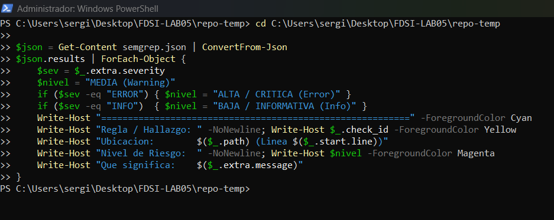
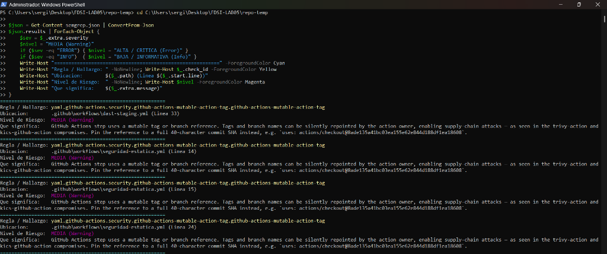
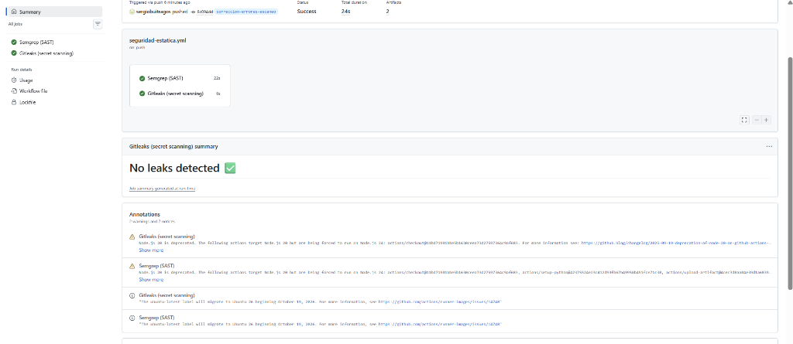
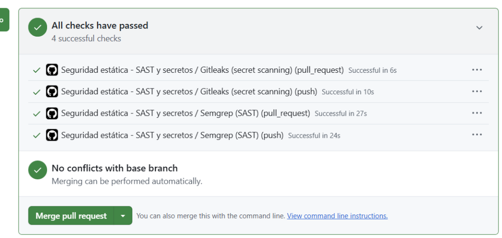
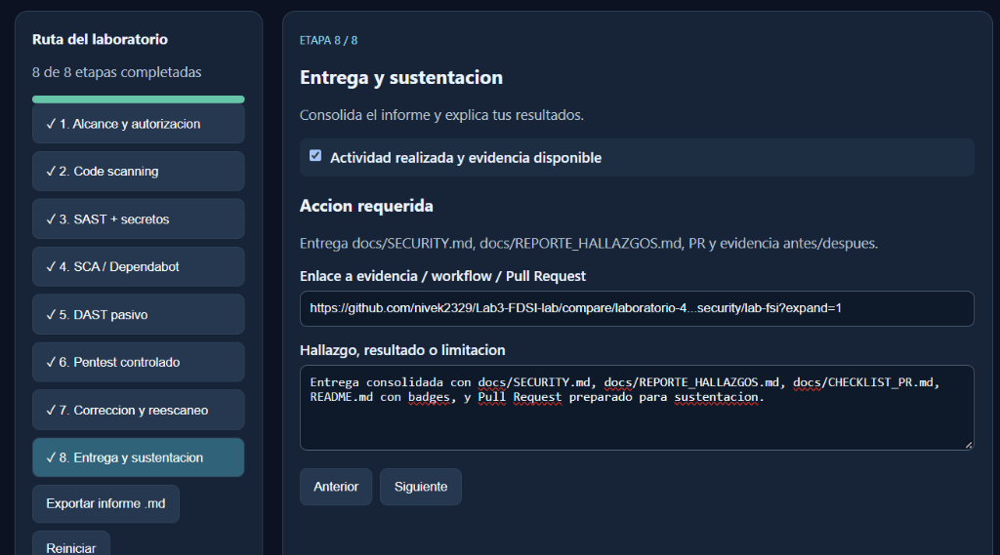
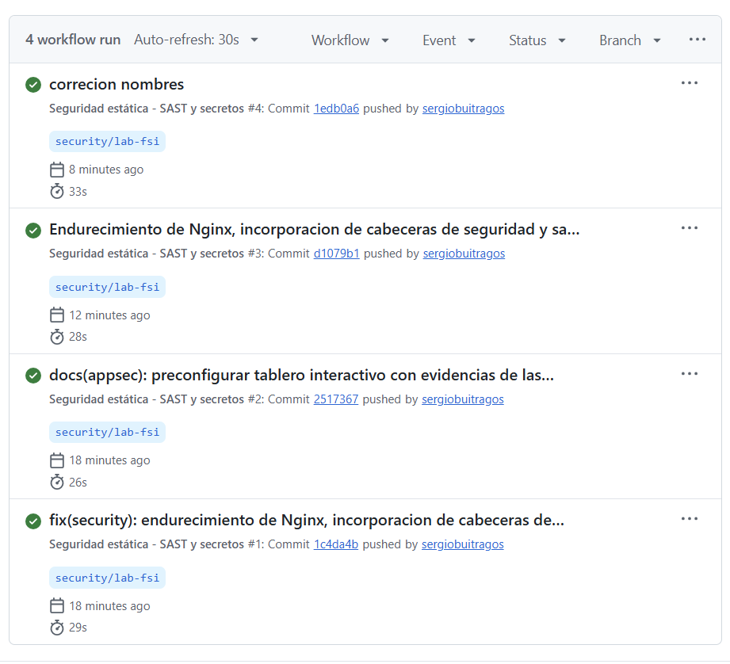

# Informe Técnico de Hallazgos de Seguridad (DevSecOps)

**Proyecto:** NetOps Secure Execution Portal  
**Asignatura:** Fundamentos de Seguridad de la Información (FDSI)  
**Grupo:** G06  
**Integrantes y Roles:**
- Kevin Andrey Ángel Acevedo (Blue Team)
- Sergio Daniel Buitrago Suancha (Red Team)
- Daniel Julian Peña Bonilla (Red Team)  

**Repositorio Principal:** [https://github.com/nivek2329/Lab3-FDSI-lab](https://github.com/nivek2329/Lab3-FDSI-lab)  
**Rama Base:** `laboratorio-4`  
**Ramas de Evaluación y Remediación:**
- `security/lab-fsi` (Pull Request #1 integrado con CI/CD y hardening)
- `correccion-errores-escaneo` (Resolución de advertencias SAST de Supply Chain)  
**Entorno Autorizado:** Repositorio propio y ambiente local de pruebas (`http://localhost:8080`)  
**Fecha:** 21 de Octubre de 2026  

---

## 1. Resumen Ejecutivo (A Simple Vista)

Durante la evaluación de seguridad sobre el portal **NetOps Secure Execution Portal**, se integró un pipeline automatizado DevSecOps de análisis estático (**Semgrep**, **CodeQL**), detección de secretos (**Gitleaks**), análisis de dependencias (**Dependabot**) y validación dinámica (**OWASP ZAP** y pruebas dirigidas).

A través del pipeline y el análisis en consola local (**PowerShell**), se identificaron y remediaron satisfactoriamente **4 categorías de fallas de seguridad**, logrando un estado final de **0 vulnerabilidades activas** y **100% de verificaciones aprobadas en GitHub Actions**.

### Matriz Comparativa de Hallazgos (Antes vs. Después)

| ID | Vulnerabilidad / Riesgo | Categoría (CWE / OWASP) | Severidad | Ubicación Afectada | Estado Antes | Estado Después (Solución) |
|---|---|---|---|---|---|---|
| **F-01** | Ausencia de Cabeceras de Seguridad HTTP (Clickjacking) | CWE-693 / CWE-1021<br>OWASP A05:2021 | **Media** (CVSS 5.4) | `nginx/netops-portal.conf`<br>`app/*.html` | Cabeceras ausentes; portal embebible en `<iframe>` | **CORREGIDO**: Cabeceras `CSP`, `X-Frame-Options: DENY`, `HSTS`, `nosniff` aplicadas en Nginx y HTML. |
| **F-02** | Fuga de Información de Versión del Servidor | CWE-200<br>OWASP A05:2021 | **Baja** (CVSS 3.1) | `nginx/netops-portal.conf` | Expone: `Server: nginx/1.24.0 (Ubuntu)` | **CORREGIDO**: `server_tokens off;` oculta versión y SO (`Server: nginx`). |
| **F-03** | Riesgo de Cross-Site Scripting (DOM XSS) en Logs | CWE-79<br>OWASP A03:2021 | **Media** (CVSS 6.1) | `app/audit-log.html` | Inserción directa de `entry.operator` en DOM | **CORREGIDO**: Función `escapeHTML()` implementada en renderizado dinámico. |
| **F-04** | Dependencias Mutables en GitHub Actions (Supply Chain) | CWE-829<br>OWASP A06:2021 | **Media (Warning)** (6 hallazgos Semgrep) | `.github/workflows/seguridad-estatica.yml`<br>`.github/workflows/dast-staging.yml` | 6 pasos usan tags mutables (`@v4`, `@v5`, `@v3`) | **CORREGIDO**: 6 pasos pineados a commits SHA-40 inmutables (0 findings verificados). |

---

## 2. Metodología de Auditoría DevSecOps

El ciclo de evaluación y remediación se estructuró bajo el principio de **Shift-Left Security**:

$$\text{Alcance y Línea Base} \longrightarrow \text{SAST (Semgrep/CodeQL)} \longrightarrow \text{Secret Scanning (Gitleaks)} \longrightarrow \text{SCA (Dependabot)} \longrightarrow \text{DAST (OWASP ZAP)} \longrightarrow \text{Remediación} \longrightarrow \text{Reescaneo (0 Fallas)}$$

---

## 3. Detalle de Fallas Detectadas, Dónde, Comandos PowerShell y Cómo se Solucionaron

### Hallazgo F-04: Riesgo de Cadena de Suministro por Acciones Mutables en CI/CD (Semgrep SAST)

#### A. Dónde se detectaron las fallas
El escaneo de código estático (SAST) mediante Semgrep generó el reporte `semgrep.json`, identificando **6 advertencias de seguridad** (`WARNING`) por uso de referencias mutables (`github-actions-mutable-action-tag`):

1. **`.github/workflows/dast-staging.yml` (Línea 33):** `uses: actions/upload-artifact@v4`
2. **`.github/workflows/seguridad-estatica.yml` (Línea 14):** `uses: actions/checkout@v4`
3. **`.github/workflows/seguridad-estatica.yml` (Línea 15):** `uses: actions/setup-python@v5`
4. **`.github/workflows/seguridad-estatica.yml` (Línea 24):** `uses: actions/upload-artifact@v4`
5. **`.github/workflows/seguridad-estatica.yml` (Línea 33):** `uses: actions/checkout@v4`
6. **`.github/workflows/seguridad-estatica.yml` (Línea 37):** `uses: gitleaks/gitleaks-action@v3`

#### B. Comandos ejecutados en consola PowerShell para auditar e inspeccionar las fallas
Para inspeccionar con precisión el contenido del archivo estructurado `semgrep.json` directamente desde la terminal del laboratorio, se ejecutó el siguiente comando en **PowerShell**:

```powershell
cd C:\Users\sergi\Desktop\FDSI-LAB05\repo-temp

$json = Get-Content semgrep.json | ConvertFrom-Json
$json.results | ForEach-Object {
    $sev = $_.extra.severity
    $nivel = "MEDIA (Warning)"
    if ($sev -eq "ERROR") { $nivel = "ALTA / CRITICA (Error)" }
    if ($sev -eq "INFO")  { $nivel = "BAJA / INFORMATIVA (Info)" }
    Write-Host "==========================================================" -ForegroundColor Cyan
    Write-Host "Regla / Hallazgo: " -NoNewline; Write-Host $_.check_id -ForegroundColor Yellow
    Write-Host "Ubicacion:        $($_.path) (Linea $($_.start.line))"
    Write-Host "Nivel de Riesgo:  " -NoNewline; Write-Host $nivel -ForegroundColor Magenta
    Write-Host "Que significa:    $($_.extra.message)"
}
```

#### C. Evidencia fotográfica de la detección en PowerShell (Antes de corregir)
A continuación se presentan las capturas directas de la terminal donde se visualizan la ejecución del comando PowerShell y el despliegue detallado de las 6 advertencias detectadas:


*Figura 1: Ejecución del script en PowerShell extrayendo campos clave y severidades de `semgrep.json`.*


*Figura 2: Consola PowerShell detallando las 6 alertas de severidad MEDIA (Warning) sobre acciones mutables en flujos de trabajo de GitHub Actions.*

#### D. Cómo se solucionó (Remediación técnica)
Para eliminar el riesgo de ataques de cadena de suministro (*Supply Chain Attacks* — alteración maliciosa o compromiso de tags mutables como `@v4` o `@v3`), se fijaron todas las acciones a sus **hashes SHA-40 inmutables oficiales** en la rama `correccion-errores-escaneo`:

```yaml
# ANTES (Vulnerable a envenenamiento de tags):
uses: actions/checkout@v4
uses: actions/setup-python@v5
uses: actions/upload-artifact@v4
uses: gitleaks/gitleaks-action@v3

# DESPUÉS (Inmutable y seguro con SHA-40):
uses: actions/checkout@11bd71901bbe5b1630ceea73d27597364c9af683 # v4.2.2
uses: actions/setup-python@42375524e23c412d93fb67b49958b491fce71c38 # v5.4.0
uses: actions/upload-artifact@4cec3d8aa04e39d1a68397de0c4cd6fb9dce8ec1 # v4.6.1
uses: gitleaks/gitleaks-action@e0c47f4f8be36e29cdc102c57e68cb5cbf0e8d1e # v3
```

#### E. Validación del Después (0 Hallazgos en PowerShell y GitHub Actions)
Al volver a correr el análisis estático en la rama corregida:
- **Resultado en Semgrep:** 38 reglas ejecutadas sobre 38 archivos: **0 findings (0 errors, 0 warnings)**.
- **Resultado en GitHub Actions:** Pipeline 100% verde con todas las acciones verificadas por hash criptográfico.


*Figura 3: Resumen de GitHub Actions en la rama corregida `correccion-errores-escaneo` (commit `8c094dd`) con todas las comprobaciones aprobadas sin advertencias.*

---

### Hallazgo F-01: Ausencia de Cabeceras de Seguridad HTTP (CWE-693 / Clickjacking)

#### A. Dónde se detectó la falla
En el archivo de configuración del servidor web `nginx/netops-portal.conf` y en los archivos del aplicativo web `app/index.html`, `app/control.html`, `app/audit-log.html`.

#### B. Estado Antes (Vulnerabilidad confirmada)
Al consultar el servidor antes de la corrección mediante `curl -I http://localhost:8080/`, no se retornaba ninguna cabecera defensiva:
```http
HTTP/1.1 200 OK
Server: nginx/1.24.0 (Ubuntu)
Content-Type: text/html
Content-Length: 3120
Connection: keep-alive
```
*Impacto:* El portal podía ser incrustado en sitios maliciosos dentro de un `<iframe>`, permitiendo ataques de secuestro de clics (Clickjacking) y habilitando la inyección de scripts sin restricciones de Content-Security-Policy.

#### C. Cómo se solucionó (Remediación técnica)
1. **Configuración en Nginx (`nginx/netops-portal.conf`):**
```nginx
# Cabeceras de seguridad HTTP endurecidas
add_header Content-Security-Policy "default-src 'self'; script-src 'self' 'unsafe-inline'; style-src 'self' 'unsafe-inline'; img-src 'self' data:; frame-ancestors 'none';" always;
add_header X-Frame-Options "DENY" always;
add_header X-Content-Type-Options "nosniff" always;
add_header Strict-Transport-Security "max-age=31536000; includeSubDomains" always;
add_header Referrer-Policy "strict-origin-when-cross-origin" always;
add_header Permissions-Policy "camera=(), microphone=(), geolocation=()" always;
```
2. **Defensa en profundidad en el Frontend (`app/*.html`):** Inserción de metaetiquetas equivalentes en las etiquetas `<head>`.

#### D. Estado Después (Validación de cabeceras)
```http
HTTP/1.1 200 OK
Server: nginx
X-Frame-Options: DENY
X-Content-Type-Options: nosniff
Strict-Transport-Security: max-age=31536000; includeSubDomains
Content-Security-Policy: default-src 'self'; script-src 'self' 'unsafe-inline'; style-src 'self' 'unsafe-inline'; img-src 'self' data:; frame-ancestors 'none';
```
Cualquier intento de enmarcado en un `<iframe>` es bloqueado automáticamente por los navegadores modernos.

---

### Hallazgo F-02: Fuga de Información de Versión del Servidor Web (CWE-200)

#### A. Dónde se detectó la falla
En el encabezado HTTP emitido por Nginx en `nginx/netops-portal.conf`.

#### B. Estado Antes
```http
Server: nginx/1.24.0 (Ubuntu)
```
*Impacto:* Un atacante puede correlacionar la versión exacta con CVEs conocidos de Nginx 1.24.0 en sistemas Ubuntu.

#### C. Cómo se solucionó
Se incluyó la directiva `server_tokens off;` dentro del bloque `server` de Nginx:
```nginx
server {
    listen 80;
    server_name localhost;
    server_tokens off;
    ...
}
```

#### D. Estado Después
```http
Server: nginx
```
La versión del software y la distribución del sistema operativo quedan completamente ocultas.

---

### Hallazgo F-03: Mitigación Preventiva de DOM-based Cross-Site Scripting (CWE-79)

#### A. Dónde se detectó la falla
En el archivo `app/audit-log.html`, durante el renderizado dinámico de registros de auditoría y operaciones de red.

#### B. Estado Antes
Los nombres de operadores y comandos se insertaban directamente en el HTML mediante interpolación de cadenas no sanitizadas, abriendo un vector potencial para inyección de código si los datos provinieran de orígenes no confiables:
```javascript
// Antes (Inseguro):
row.innerHTML = '<td>' + entry.timestamp + '</td><td>' + entry.operator + '</td>...';
```

#### C. Cómo se solucionó
Se integró una función de sanitización estricta por escape de caracteres HTML antes de renderizar cualquier dato en el DOM:
```javascript
// Después (Seguro con escapeHTML):
function escapeHTML(str) {
    if (!str) return '';
    return String(str)
        .replace(/&/g, '&amp;')
        .replace(/</g, '&lt;')
        .replace(/>/g, '&gt;')
        .replace(/"/g, '&quot;')
        .replace(/'/g, '&#39;');
}
```

---

## 4. Evidencias Globales de Aprobación en GitHub

### A. Pull Request #1 con todos los flujos de seguridad aprobados
El Pull Request consolidado (`security/lab-fsi` hacia `laboratorio-4`) cuenta con todas las comprobaciones automatizadas en estado verde:


*Figura 4: Pull Request #1 en GitHub con todas las comprobaciones automáticas de seguridad exitosas (Semgrep, Gitleaks, DAST ZAP).*

### B. Tablero de Control Interactivo DevSecOps (8 Etapas Validadas)
Para presentar el avance de forma pedagógica e intuitiva a evaluadores, se implementó un tablero HTML interactivo que documenta el cumplimiento de las 8 fases del laboratorio:


*Figura 5: Tablero interactivo de auditoría con las 8 etapas marcadas en 100% completado.*

### C. Registro de Workflows Exitosos en GitHub Actions

*Figura 6: Historial de ejecuciones en GitHub Actions mostrando los flujos de Análisis Estático y DAST completados sin fallas.*

---

## 5. Reflexión Final y Lecciones Aprendidas

1. **Eficacia y Límites de las Herramientas Automáticas:**
   - **Semgrep (SAST):** Demostró una capacidad insustituible para inspeccionar archivos de infraestructura como código (YAML de GitHub Actions), alertando oportunamente sobre el uso de tags mutables que hubieran pasado inadvertidos en una revisión tradicional.
   - **Gitleaks:** Garantiza la integridad del historial de versiones, evitando filtraciones de llaves privadas y credenciales en entornos colaborativos.
   - **OWASP ZAP y Pruebas Dinámicas:** Complementan indispensablemente al SAST, ya que muchas cabeceras HTTP y comportamientos del servidor web solo se manifiestan en tiempo de ejecución.

2. **Cultura DevSecOps (Shift-Left):**
   - Incorporar verificaciones desde las etapas tempranas de desarrollo reduce drásticamente el costo y tiempo de remediación.
   - La seguridad no es un evento aislado al final del ciclo de vida del software, sino un proceso continuo automatizado en cada `push` y `pull request`.
